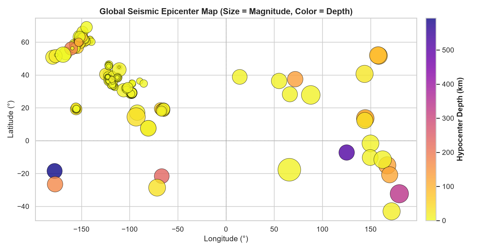
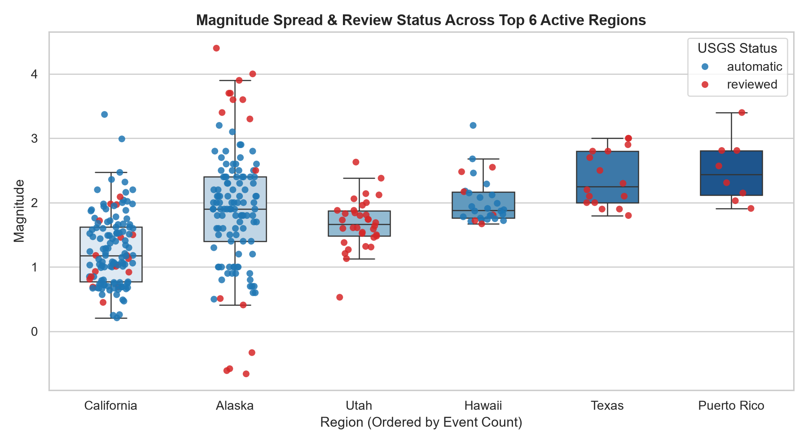

# Earthquake Data Analysis Pipeline

An end-to-end data engineering and statistical analysis pipeline built on real-time seismic data from the **USGS Earthquake Hazards Program API**. The project covers data ingestion, Kafka streaming, schema validation, vectorized feature engineering, idempotent SQLite storage, hypothesis testing, and geospatial visualization.

---

## Pipeline Architecture

```text
USGS GeoJSON API ──▶ api_client.py ──▶ producer.py ──▶ [ Apache Kafka ]
                                                              │
                                                              ▼
figures/*.png ◀── analysis.py ◀── earthquakes.db ◀── loader.py ◀── cleaner.py ◀── consumer.py (Pandera)
```

1. **Ingestion (`api_client.py`)** — Fetches the 200 most recent earthquake events from the USGS API and stores raw GeoJSON (`raw_data.json`).
2. **Streaming (`producer.py`)** — Flattens GeoJSON features and publishes them to Apache Kafka keyed by event `id`.
3. **Validation (`consumer.py`, `test_consumer.py`)** — Reads messages from Kafka, enforces strict data quality rules via **Pandera** (coordinate bounds, finite numbers, Unix ms timestamps), rejects malformed records, and exports `validated_earthquakes.json`.
4. **Cleaning & Feature Engineering (`cleaner.py`)** — Handles missing values, converts Unix timestamps to UTC, extracts normalized regions, and applies vectorized **NumPy** transformations:
   - Estimates released seismic energy using the Gutenberg–Richter relation: $\log_{10}(E) = 4.8 + 1.5M$.
   - Classifies events by magnitude (`micro`, `minor`, `light`, `moderate_plus`) and depth (`shallow`, `intermediate`, `deep`).
5. **Storage (`loader.py`)** — Persists cleaned records into SQLite (`earthquakes.db`) using `id` as `PRIMARY KEY` and `INSERT OR IGNORE` to guarantee idempotency across repeated runs.
6. **Statistical Analysis & Visualization (`analysis.py`)** — Queries SQLite directly, computes descriptive statistics, correlations, and hypothesis tests, and generates 4 high-resolution charts in `figures/`.

---

## Key Analytical Findings (200-Event Snapshot)

- **Seismic Energy Dominance:** Total released energy across all 200 earthquakes is $1.707 \times 10^{13}\text{ J}$ ($\approx 4{,}080$ tons of TNT). A single M5.2 event near the Kermadec Islands accounts for more energy than the remaining 199 events combined.
- **Hypothesis Test (Mann–Whitney U):** Testing whether seismologist-reviewed (`reviewed`, 50.5%) events are stronger than automated (`automatic`) detections yields $U = 6706.5$, $p = 1.52 \times 10^{-5} < 0.05$. This confirms with high statistical significance that USGS prioritizes manual review for stronger earthquakes.
- **Depth–Magnitude Correlation:** Pearson $r = 0.450$, Spearman $\rho = 0.533$ (moderate positive correlation). Deep-focus earthquakes (up to $593.7\text{ km}$ in the Fiji region) skew toward higher magnitudes because weak deep tremors attenuate before reaching surface sensors.
- **Regional Hotspots:** California (56 events, median $\approx 1.1$) and Alaska (51 events, wider magnitude/depth spread) dominate event counts, with epicenters closely tracing the Pacific Ring of Fire.

---

## Visualizations

Running the pipeline generates 4 charts in `figures/`:

| Chart | Description |
| :--- | :--- |
| `01_spatial_epicenter_map.png` | Global epicenter scatter map encoding longitude, latitude, magnitude (size), and hypocenter depth (color). |
| `02_regional_magnitude_boxplot.png` | Combined boxplot and jittered stripplot comparing magnitude spread and review status across the top 6 regions. |
| `03_depth_vs_energy_log.png` | Hypocenter depth vs. released seismic energy on a $\log_{10}$ scale, segmented by verification status. |
| `04_hourly_activity_stacked.png` | 24-hour UTC seismic activity profile stacked by magnitude class. |




---

## Project Structure

```text
earthquake-data-analysis/
├── api_client.py               # USGS API fetcher
├── producer.py                 # Kafka producer
├── consumer.py                 # Kafka consumer + Pandera validation
├── test_consumer.py            # Unit tests for schema validation
├── cleaner.py                  # Pandas/NumPy cleaning & feature engineering
├── loader.py                   # Idempotent SQLite loader
├── analysis.py                 # Statistical tests & chart generation
├── main.py                     # Unified pipeline entry point
├── validated_earthquakes.json  # Validated dataset snapshot (200 records)
├── figures/                    # Generated PNG charts
├── requirements.txt            # Python dependencies
├── .gitignore
└── README.md
```

---

## Quick Start

### 1. Install Dependencies
```bash
pip install -r requirements.txt
```

### 2. Run the Pipeline
- **Standard mode** (uses the included `validated_earthquakes.json` — no Kafka required):
  ```bash
  python main.py
  ```
- **Full end-to-end mode** (fetches live USGS data and streams through a running Kafka broker):
  ```bash
  python main.py --full
  ```

### 3. Run Validation Unit Tests
```bash
python -m unittest test_consumer.py
```

---

## Tech Stack

- **Data Processing & Math:** `pandas`, `numpy`, `scipy`
- **Visualization:** `matplotlib`, `seaborn`
- **Storage:** `sqlite3`
- **Streaming & Validation:** `kafka-python-ng`, `pandera`, `requests`